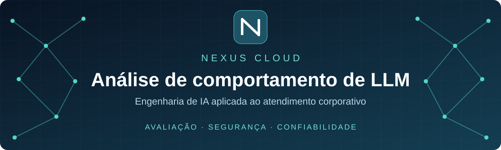
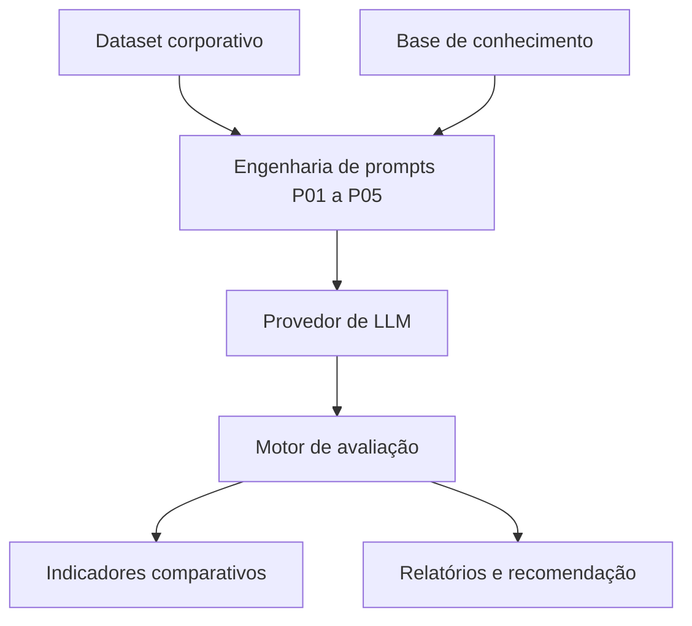

<div align="center">



# Análise de Comportamento de LLM para Atendimento Corporativo

**Engenharia de prompts · Avaliação experimental · Inteligência artificial responsável**

  

[Visão geral](#-visão-geral) · [Arquitetura](#-arquitetura-da-solução) · [Stack](#-stack-tecnológica-prevista) · [Dataset](#-dataset-corporativo) · [Experimentos](#-estratégias-de-engenharia-de-prompts) · [Roadmap](#-roadmap) · [Documentação](#-documentação-empresarial)

</div>

---

## 📖 Visão geral

Este projeto tem como objetivo investigar, avaliar e comparar o comportamento de grandes modelos de linguagem (LLMs) aplicados ao atendimento corporativo, utilizando diferentes estratégias de engenharia de prompts.

A solução propõe uma abordagem experimental, estruturada e reproduzível, capaz de gerar evidências técnicas que apoiem decisões relacionadas à adoção de inteligência artificial em operações de atendimento ao cliente.

## ✨ Diferenciais da solução

| Capacidade | Finalidade |
|---|---|
| 🧠 Engenharia de prompts | Cinco estratégias comparáveis |
| 📚 Contexto corporativo | Base de conhecimento versionada |
| 🛡️ Segurança | Avaliação de violações e alucinações |
| 📊 Benchmark | Comparação quantitativa e qualitativa |
| 🔬 Reprodutibilidade | Condições experimentais controladas |
| 📋 Governança | Rastreabilidade e decisões arquiteturais |

## Contexto empresarial

O cenário de referência é a **Nexus Cloud**, empresa fictícia brasileira de SaaS B2B voltada à gestão empresarial. Os indicadores operacionais são premissas simuladas, não dados reais.

Empresas que oferecem software como serviço (SaaS) enfrentam desafios relacionados à escalabilidade do atendimento, à padronização das informações e à manutenção da qualidade da experiência dos clientes.

A utilização de modelos de linguagem apresenta oportunidades de automação e eficiência operacional. Entretanto, a natureza probabilística desses modelos introduz riscos que precisam ser avaliados antes de sua adoção em ambientes corporativos.

Entre esses riscos, destacam-se a geração de informações incorretas, a inconsistência das respostas, o descumprimento de políticas empresariais e a inadequação da comunicação com os clientes.

## Problema de negócio

Como identificar uma estratégia de engenharia de prompts capaz de proporcionar respostas claras, completas, consistentes e seguras em um ambiente de atendimento corporativo?

A ausência de uma avaliação estruturada dificulta a identificação dos riscos e a definição de uma estratégia confiável para a utilização de LLMs nesse contexto.

## Objetivo geral

Avaliar experimentalmente diferentes estratégias de engenharia de prompts, identificando seus impactos sobre a qualidade, a segurança e a confiabilidade das respostas geradas por modelos de linguagem.

## Objetivos específicos

- Construir um conjunto representativo de cenários de atendimento ao cliente.
- Desenvolver e versionar cinco estratégias de engenharia de prompts.
- Executar experimentos sob condições controladas.
- Avaliar a qualidade e a consistência das respostas geradas.
- Identificar riscos de geração de informações não fundamentadas.
- Verificar a aderência das respostas às políticas corporativas.
- Consolidar indicadores comparativos de desempenho.
- Elaborar uma recomendação técnica fundamentada em evidências.

## Escopo da solução

O projeto contempla:

- Construção e gerenciamento de datasets.
- Estruturação de uma base de conhecimento corporativa.
- Desenvolvimento e versionamento de prompts.
- Integração com provedores de modelos de linguagem.
- Automação da execução experimental.
- Avaliação estruturada das respostas.
- Análise comparativa dos resultados.
- Geração de relatórios técnicos e executivos.

A implantação de um assistente virtual em produção e a integração com sistemas reais de atendimento não fazem parte do escopo inicial.

## 📊 Dataset corporativo

  

O benchmark DS-NEXUS-001 contém 30 cenários sintéticos de atendimento, distribuídos em cinco categorias, com entradas e referências de avaliação separadas.

| Categoria | Casos |
|---|---:|
| Suporte técnico | 8 |
| Dúvidas operacionais | 6 |
| Financeiro e cobrança | 6 |
| Planos e assinaturas | 5 |
| Segurança e acessos | 5 |
| **Total** | **30** |

| Artefato | Acesso |
|---|---|
| Dataset completo | [CSV](data/processed/benchmark_dataset.csv) |
| Entradas experimentais | [JSONL](data/processed/benchmark_inputs.jsonl) |
| Referências de avaliação | [JSONL](data/processed/benchmark_expectations.jsonl) |
| Manifesto | [JSON](data/processed/dataset_manifest.json) |
| Dataset Card | [Documentação](docs/methodology/dataset_card.md) |
| Decisão arquitetural | [ADR-002](docs/decisions/ADR-002-dataset-design.md) |

**Status:** dataset sintético aprovado pelo responsável do projeto; fontes públicas individuais não verificadas. Volume previsto: 450 respostas (30 casos × 5 estratégias × 3 repetições).

## 🧪 Estratégias de engenharia de prompts

| Identificador | Estratégia |
|---|---|
| P01 | Prompt simples — referência comparativa |
| P02 | Prompt com definição de papel |
| P03 | Prompt com estrutura explícita de saída |
| P04 | Prompt com exemplos (Few-shot) |
| P05 | Prompt com restrições e políticas corporativas |

**Status:** cinco templates aprovados e versionados (v1.0.0).

- [P01 — baseline](prompts/p01_baseline.txt)
- [P02 — role](prompts/p02_role.txt)
- [P03 — structured](prompts/p03_structured.txt)
- [P04 — few_shot](prompts/p04_few_shot.txt)
- [P05 — policy_constrained](prompts/p05_policy_constrained.txt)

[Catálogo de prompts](prompts/README.md) · [Registro YAML](prompts/prompt_registry.yaml) · [Metodologia](docs/methodology/prompt_engineering.md) · [ADR-003](docs/decisions/ADR-003-prompt-strategy.md)

## Critérios de avaliação

As respostas serão avaliadas considerando as seguintes dimensões:

| Critério | Descrição |
|---|---|
| Clareza | Facilidade de compreensão da resposta. |
| Completude | Capacidade de atender integralmente à solicitação. |
| Tom corporativo | Adequação da linguagem ao contexto empresarial. |
| Segurança | Respeito às políticas e aos limites operacionais. |
| Consistência | Estabilidade do comportamento entre diferentes execuções. |
| Risco de alucinação | Geração de informações incorretas ou não fundamentadas. |

**Framework v1.0.0 aprovado:** clareza 15%, completude 20%, tom 10%, segurança 25%, consistência 15% e fundamentação 15%. SGD 0–100; violações críticas bloqueiam aprovação. Avaliação híbrida, revisão humana e análise pareada. Custo e latência são indicadores complementares.

[Framework](docs/methodology/evaluation_framework.md) · [Rubricas](docs/methodology/evaluation_rubrics.md) · [Métricas](docs/methodology/metrics_definition.md) · [Critérios de decisão](docs/methodology/decision_framework.md) · [Configuração YAML](config/evaluation_config.yaml) · [ADR-004](docs/decisions/ADR-004-evaluation-strategy.md).

## 🏗️ Arquitetura da solução

A implementação inicial utiliza uma arquitetura modular, com separação de responsabilidades entre os componentes de gerenciamento de dados, integração com modelos de linguagem, execução experimental, avaliação e análise de resultados.

Essa abordagem busca favorecer a manutenção, a extensibilidade e a reprodução dos experimentos.

### Fluxo experimental planejado



### Documentação técnica da arquitetura

| Documento | Conteúdo |
|---|---|
| [Arquitetura de software](docs/architecture/software_architecture.md) | Camadas, dependências, contratos, diagramas de componentes e sequência, segurança e persistência. |
| [Referência arquivo por arquivo](docs/architecture/file_reference.md) | Inventário de todos os arquivos versionados, funções, responsabilidades e links diretos ao código. |
| [Fluxo da aplicação](docs/architecture/application_flow.md) | Comandos e percurso operacional. |

### Fluxo da aplicação Python

A CLI valida os artefatos, compõe prompts, planeja tarefas e encaminha execução, avaliação e análise aos módulos especializados. Consulte a [documentação do fluxo da aplicação](docs/architecture/application_flow.md) para entender os componentes, comandos e armazenamento.

## 🛠️ Stack tecnológica prevista

<div align="center">


</div>

| Tecnologia | Responsabilidade |
|---|---|
| Python 3.12 | Linguagem principal |
| OpenAI SDK | Integração inicial com LLMs |
| Pandas | Manipulação de dados |
| NumPy | Cálculos estatísticos |
| Matplotlib | Visualização |
| Pydantic | Validação de schemas |
| Python-dotenv | Variáveis de ambiente |
| Pytest | Testes unitários e de integração |
| Ruff | Linting e formatação |
| uv | Dependências e ambientes |
| Git | Controle de versão |
| GitHub | Colaboração e rastreabilidade |
| GitHub Actions | Automação de verificações |
| Markdown | Documentação empresarial e técnica |
| Mermaid | Arquitetura e fluxos |
| CSV / JSON / YAML | Dados e configurações |

Git, GitHub, Markdown e Mermaid já são utilizados na documentação. As demais ferramentas são previstas; a escolha final do provedor depende de acesso e custo. Não há infraestrutura de produção, banco vetorial ou RAG nesta fase.

## 🧭 Princípios de engenharia

Clean Code, SOLID, separação de responsabilidades, arquitetura independente de provedor, Security by Design, IA responsável e testes automatizados são diretrizes previstas.

- Arquitetura modular.
- Separação de responsabilidades.
- Segurança desde a concepção.
- Rastreabilidade dos experimentos.
- Reprodutibilidade dos resultados.
- Manutenibilidade do código.
- Governança de inteligência artificial.
- Tomada de decisão baseada em evidências.

## 📁 Estrutura do projeto

```text
micro-capstone-02-llm-behavior-analysis/
├── config/
├── data/
│   ├── raw/
│   ├── processed/
│   └── knowledge_base/
├── prompts/
├── src/
│   ├── __main__.py
│   ├── cli.py
│   ├── core/
│   ├── data/
│   ├── prompting/
│   ├── providers/
│   ├── experiments/
│   ├── infrastructure/
│   ├── evaluation/
│   ├── analytics/
│   └── reporting/
├── tests/
├── results/
│   ├── raw/
│   ├── evaluated/
│   └── reports/
├── docs/
│   ├── assets/
│   ├── business/
│   ├── architecture/
│   ├── methodology/
│   ├── decisions/
│   └── operations/
├── .github/workflows/ci.yml
├── pyproject.toml
├── .python-version
├── .env.example
├── .gitignore
└── README.md
```

| Diretório | Responsabilidade |
|---|---|
| config/ | Configurações dos experimentos. |
| data/ | Datasets e base de conhecimento. |
| prompts/ | Estratégias de engenharia de prompts. |
| src/ | Componentes de implementação da solução. |
| tests/ | Testes automatizados. |
| results/ | Resultados, indicadores e evidências. |
| docs/ | Documentação empresarial e técnica. |

## Entregáveis

- Dataset de cenários de atendimento.
- Base de conhecimento corporativa.
- Cinco estratégias de prompts versionadas.
- Pipeline de execução experimental.
- Metodologia de avaliação.
- Matriz comparativa de resultados.
- Relatório técnico e executivo.
- Recomendação para adoção da solução.

## Segurança e governança

O projeto deverá utilizar dados simulados ou devidamente anonimizados, evitando a exposição de informações pessoais, credenciais e dados corporativos confidenciais.

As configurações sensíveis serão gerenciadas por meio de variáveis de ambiente e não serão armazenadas no controle de versão.

## 📚 Documentação empresarial

- [Perfil da empresa](docs/business/company_profile.md)
- [Contexto empresarial](docs/business/business_context.md)
- [Solicitação da iniciativa](docs/business/business_case.md)
- [Partes interessadas](docs/business/stakeholders.md)
- [Requisitos](docs/business/requirements.md)
- [Escopo](docs/business/scope.md)
- [Critérios de sucesso](docs/business/success_criteria.md)
- [Avaliação de riscos](docs/business/risk_assessment.md)

## Base de conhecimento corporativa

A [base de conhecimento Nexus Cloud v1.0.0](data/knowledge_base/README.md) reúne catálogo, preços, políticas e procedimentos simulados. A [ADR-001](docs/decisions/ADR-001-knowledge-base-strategy.md) registra a decisão de utilizar contexto direto comum às cinco estratégias, sem RAG nesta fase.

## 📈 Roadmap


**8 de 13 etapas concluídas**

| Etapa | Status |
|---|---|
| 1. Leitura dos requisitos | ✅ Concluído |
| 2. Criação e conexão do repositório | ✅ Concluído |
| 3. Estrutura inicial | ✅ Concluído |
| 4. Cenário corporativo | ✅ Concluído |
| 5. Base de conhecimento | ✅ Concluído |
| 6. Dataset | ✅ Concluído — dataset aprovado |
| 7. Engenharia de prompts | ✅ Concluído — v1.0.0 |
| 8. Critérios de avaliação | ✅ Concluído — v1.0.0 |
| 9. Implementação Python | 🟡 Em desenvolvimento — validação local de planejamento concluída — testes pendentes |
| 10. Execução dos experimentos | ⬜ Planejado |
| 11. Análise dos resultados | ⬜ Planejado |
| 12. Relatórios | ⬜ Planejado |
| 13. Revisão final e publicação | ⬜ Planejado |

## Execução local (pipeline inicial)

`uv sync` e `uv run python -m src validate` ou `uv run python -m src plan`. Use também `uv run python -m src run --dry-run` e `uv run pytest`. [Guia de instalação](docs/operations/setup_guide.md) · [ADR-005](docs/decisions/ADR-005-software-architecture.md). O lockfile e a validação do ambiente ainda estão pendentes. Nenhuma chamada externa é realizada por esses comandos.

## Status do projeto

**Em desenvolvimento — Prova de conceito**

A estrutura inicial, o cenário corporativo e a base de conhecimento estão definidos. O dataset com 30 casos está publicado e aprovado pelo responsável do projeto. As cinco estratégias de prompts v1.0.0 estão aprovadas e versionadas. O framework de avaliação v1.0.0 está aprovado e versionado. A implementação Python foi iniciada: schemas, carregadores, composição de prompts e planejamento estão disponíveis. Adaptador OpenAI, persistência JSONL e controle preventivo de custos implementados inicialmente. CLI, avaliação semântica e de consistência, fila de revisão, métricas, bootstrap, ranking e relatório inicial disponíveis. Revisão humana importável, avaliação determinística, retries, rastreabilidade integral, lockfile e testes completos ainda pendentes. Nenhuma chamada real realizada. Os resultados, indicadores e recomendações serão disponibilizados após a execução e validação dos experimentos.

O projeto não constitui, neste estágio, uma solução homologada para utilização em produção.

---

<div align="center">

**Nexus Cloud — Engenharia de IA**

Engenharia de inteligência artificial orientada por evidências.

</div>

### Registro de validação local — 25/11/2026

Validação e dry-run confirmados em Python 3.12: 30 casos, cinco prompts, 450 tarefas e zero chamadas pagas. Corrigidos o caminho de importação do Pytest e os 14 apontamentos de lint reportados. Formatação e nova execução dos testes ainda precisam de confirmação; cobertura não aferida.

### Validação automatizada com Make

No Ubuntu, instale o GNU Make se necessário (`sudo apt install make`). Execute `make test` na raiz do repositório. O alvo sincroniza dependências, valida artefatos, executa dry-run, Ruff (lint e formatação) e Pytest com cobertura. Todas as verificações são executadas mesmo se alguma falhar. A saída padrão e os erros são exibidos no terminal e gravados em `logs/test_results.txt`, sobrescrito a cada execução. O comando retorna falha se qualquer verificação falhar. Não realiza chamadas pagas à API. Envie esse arquivo para análise, após verificar se não contém informações sensíveis. `make format` é opcional e modifica os arquivos locais; `make test` não formata o código.

### Validação ampliada — 25/11/2026

Baseline local informado: 12 testes aprovados, cobertura de 27%, lint e formatação aprovados, zero chamadas pagas. O lockfile publicado pelo responsável foi preservado. Novos testes unitários e de integração usam mocks para geração e avaliação, incluindo retomada, decisão, ranking, CLI e relatórios. Makefile e CI exigem cobertura de 85% e sincronização com lockfile. A nova suíte ainda precisa ser executada; não há confirmação de cobertura ou homologação. Use `make test` e consulte `logs/test_results.txt`.

### Evidência de validação local — 25/11/2026

Commit testado: `7954a5c`. Ambiente limpo, dependências bloqueadas, 28 testes aprovados em 14,45 s, cobertura de instruções de 86,91% (meta 85% atingida), Ruff lint aprovado e dry-run sem chamadas pagas. O único erro foi de formatação em `test_pipeline.py`, corrigido conforme o diff do Ruff. Nova execução necessária para confirmar resultado geral zero. A homologação funcional completa permanece pendente.
