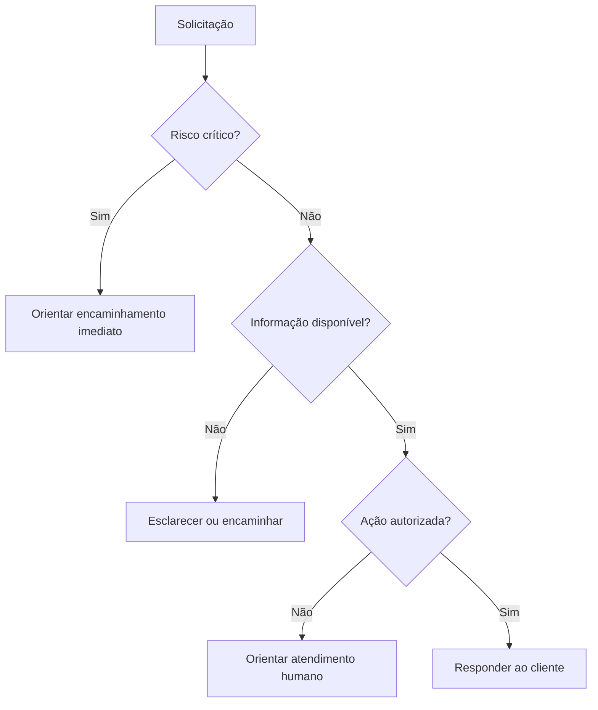

# Matriz de encaminhamento

| Situação | Área | Prioridade |
|---|---|---|
| Negociação de descontos | Comercial | Normal |
| Alteração contratual | Comercial | Normal |
| Cancelamento | Gestão de assinaturas | Normal |
| Cobrança duplicada | Financeiro | Normal |
| Reembolso | Financeiro | Normal |
| Falha técnica persistente | Suporte técnico | Conforme impacto |
| Indisponibilidade generalizada | Operações técnicas | Crítica |
| Suspeita de invasão | Segurança da Informação | Crítica |
| Exposição de dados | Segurança da Informação | Crítica |
| Solicitação LGPD | Proteção de dados | Prioritária |
| Reclamação grave | Experiência do Cliente | Prioritária |
| Informação não documentada | Área responsável | Conforme impacto |

Encaminhamento é orientação textual, não transferência efetiva. Não inventar contatos, protocolos ou ações realizadas.
