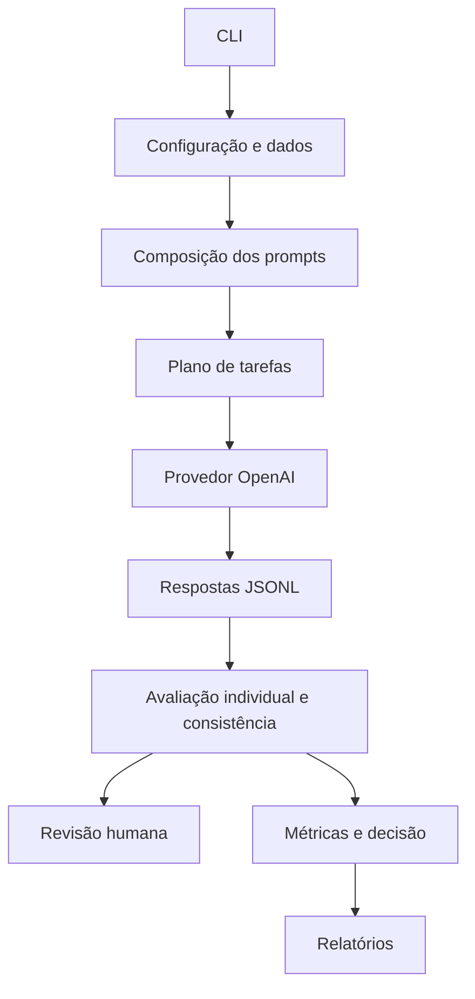

# Fluxo da aplicação Python

Autor: Carlos Adriano  
Data: 25/11/2026

## Arquitetura e execução

O ponto de entrada `python -m src` chama `src.cli.main`. A CLI valida configurações, dataset, referências, base corporativa e prompts antes de encaminhar o comando.



| Módulo | Responsabilidade |
|---|---|
| core | Configurações e contratos Pydantic. |
| data | Entradas, expectativas e nove documentos corporativos. |
| prompting | Registro e composição dos cinco prompts; pergunta separada das instruções. |
| experiments | Planejamento de 450 tarefas, execução sequencial e retomada conservadora. |
| providers | Contrato, fábrica e adaptador OpenAI. |
| infrastructure | Hashes, persistência JSONL e controle de orçamento. |
| evaluation | Avaliação individual, comparação de pares e fila de revisão. |
| analytics | Normalização, SGD, agregação, decisão, ranking e bootstrap. |
| reporting | CSV, JSON e gráfico SGD. |

## Comandos

- validate: valida artefatos e composição.
- plan: imprime plano JSON.
- estimate e run --dry-run: contam chamadas sem acessar API.
- run --execute: exige modelo, credenciais, preços e orçamento; grava manifesto, tentativas e respostas.
- evaluate --run-id RUN_ID --execute: avalia respostas e pares; gera custos.
- review --run-id RUN_ID --export: exporta fila de revisão.
- analyze --run-id RUN_ID: consolida indicadores.
- report --run-id RUN_ID: exporta relatórios.
- status --run-id RUN_ID: consulta contagens.

Os resultados ficam em results/raw, results/evaluated e results/reports, separados por RUN_ID. As credenciais ficam no ambiente local.

## Validação sem custos

```bash
uv sync
uv run python -m src validate
uv run python -m src run --dry-run
uv run pytest
```

## Limitações

Implementação inicial ainda não validada integralmente. Lockfile, retries, avaliação determinística, importação de revisão humana, rastreabilidade integral e integração de ranking e bootstrap à CLI permanecem pendentes. A decisão permanece inconclusiva sem revisão e rastreabilidade. Nenhum resultado real foi produzido nesta etapa.
