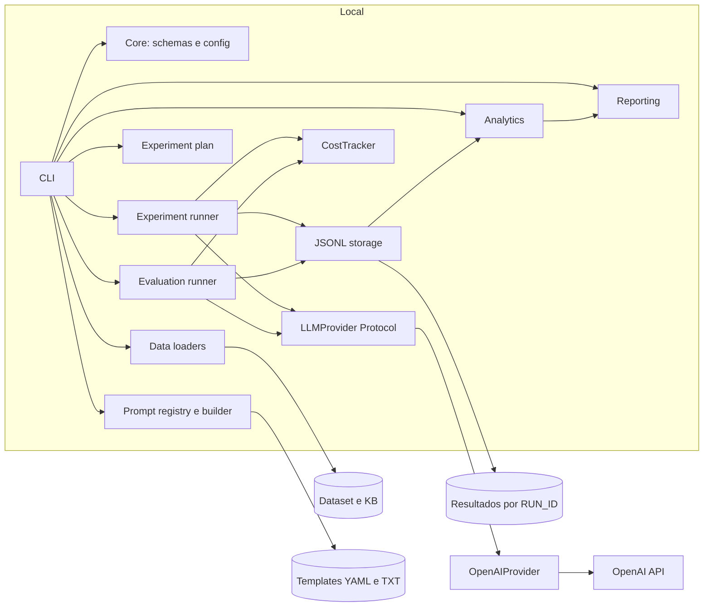
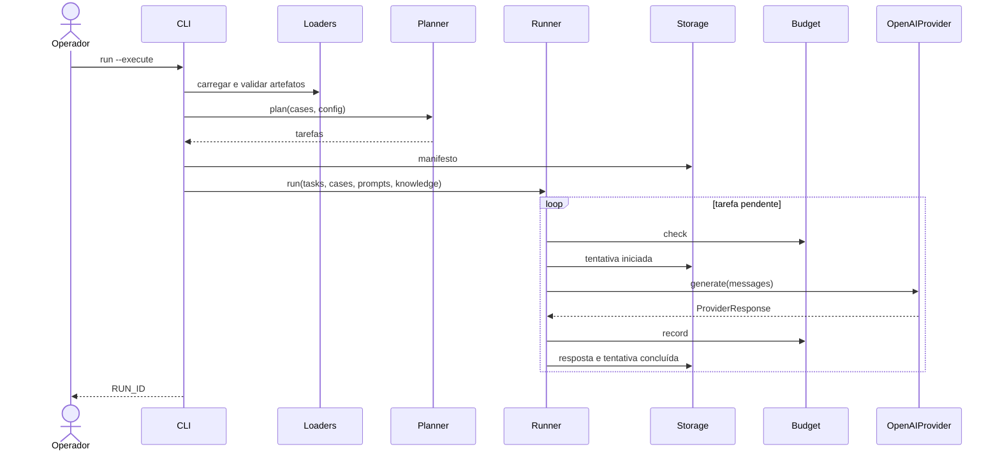
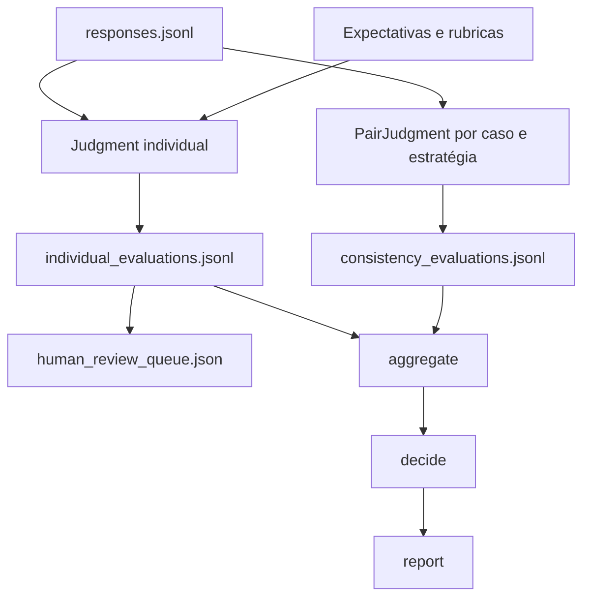

# Arquitetura de software — Nexus Cloud

**Autor:** Carlos Adriano · **Data:** 25/11/2026

## 1. Contexto e objetivo

A aplicação é uma PoC experimental executada localmente por CLI. Compara cinco estratégias sobre 30 casos sintéticos, com três repetições. Não é serviço web nem chatbot de produção. A arquitetura modular inspira-se em Ports & Adapters: o runner depende do contrato LLMProvider, não do SDK concreto. Não se afirma conformidade integral com Clean Architecture.

## 2. Diagrama de componentes

## 3. Camadas e dependências

| Camada | Responsabilidade | Dependências |
|---|---|---|
| Entrada | CLI e seleção de casos/comandos | core, data, prompting, experiments e demais serviços |
| Núcleo | Modelos Pydantic e configuração | Pydantic, PyYAML |
| Aplicação | Planejamento, execução e avaliação | contratos, dados, prompts, armazenamento e orçamento |
| Adaptadores | Integração externa e persistência | SDK OpenAI, filesystem |
| Análise | Métricas, decisão, ranking, bootstrap | registros, NumPy |
| Apresentação | CSV, JSON, gráfico | Pandas, Matplotlib |

O padrão Adapter está em OpenAIProvider; Factory em create_provider; injeção de dependência em ExperimentRunner(provider, storage, budget, max_output_tokens); Protocol em LLMProvider. O fluxo é sequencial, sem banco de dados, filas ou RAG. Não existe implementação completa de todos os padrões previstos no ADR.

## 4. Sequência da execução

Sem --execute a CLI bloqueia chamadas reais. Com --dry-run retorna apenas contagens. O manifesto compara tarefas, parâmetros, modelo e hashes na retomada. Se uma tentativa ficou incerta, o runner interrompe em vez de repetir automaticamente. Não há transação entre arquivos.

## 5. Contratos e exemplo de percurso

TC-001 entra como BenchmarkInput (case_id, channel, customer_query). A expectativa correspondente fica separada em BenchmarkExpectation. O planner gera ExperimentTask para cada combinação; por exemplo TC-001-P01-1. build_messages usa o template P01 e a KB para criar duas LLMMessage: system com instruções/contexto e user com a pergunta. O adaptador retorna ProviderResponse com texto, modelo, tokens e ID. O runner grava metadados e texto em responses.jsonl. Este é um exemplo de identificação, não uma resposta experimental real.

## 6. Avaliação e análise

O juiz recebe pergunta, resposta, referências e rubricas; o ID da estratégia não é incluído no conteúdo enviado. O agrupamento completo tem três respostas e três pares. O SGD usa notas normalizadas e consistência percentual. A decisão fica inconclusiva enquanto revisão e rastreabilidade não forem verificadas. Ranking e bootstrap existem como funções independentes, ainda não chamados pela CLI.

## 7. Persistência e segurança

| Caminho relativo ao RUN_ID | Conteúdo |
|---|---|
| results/raw/RUN_ID/run_manifest.json | Tarefas, configuração, modelo e hashes |
| results/raw/RUN_ID/attempts.jsonl | Eventos de início e sucesso |
| results/raw/RUN_ID/responses.jsonl | Respostas ou falhas, metadados e custo estimado |
| results/evaluated/RUN_ID/individual_evaluations.jsonl | Notas, evidências e sinalização de revisão |
| results/evaluated/RUN_ID/consistency_evaluations.jsonl | Equivalências e evidências dos pares |
| results/evaluated/RUN_ID/human_review_queue.json | Fila exportada |
| results/reports/RUN_ID/strategy_metrics.csv | Indicadores por estratégia |
| results/reports/RUN_ID/decision_summary.json | Resumo das decisões |
| results/reports/RUN_ID/sgd.png | Gráfico quando existem dados válidos |

Credenciais vêm de variáveis de ambiente. Preços devem ser preenchidos antes da execução real. O controle de orçamento é estimativo, não garantia de cobrança máxima. Não há ferramentas externas habilitadas para o modelo. Não publique dados sensíveis ou resultados sem revisão.

## 8. Como navegar no código

Comece em [src/__main__.py](../../src/__main__.py), depois [src/cli.py](../../src/cli.py), [schemas](../../src/core/schemas.py), [planner](../../src/experiments/experiment_plan.py), [runner](../../src/experiments/experiment_runner.py), [avaliação](../../src/evaluation/evaluation_runner.py) e [métricas](../../src/analytics/metrics.py). A [referência arquivo por arquivo](file_reference.md) explica cada arquivo e suas funções, com links diretos. Consulte [fluxo e comandos](application_flow.md) e [instalação](../operations/setup_guide.md).

## 9. Limites da implementação atual

Não há validação integral executada nesta atualização. Lockfile, retries, avaliação determinística, importação de revisão, rastreabilidade completa, integração de ranking e bootstrap, testes de integração/E2E e cobertura de 85% permanecem pendentes. A arquitetura documentada descreve o código existente e não implica homologação.
