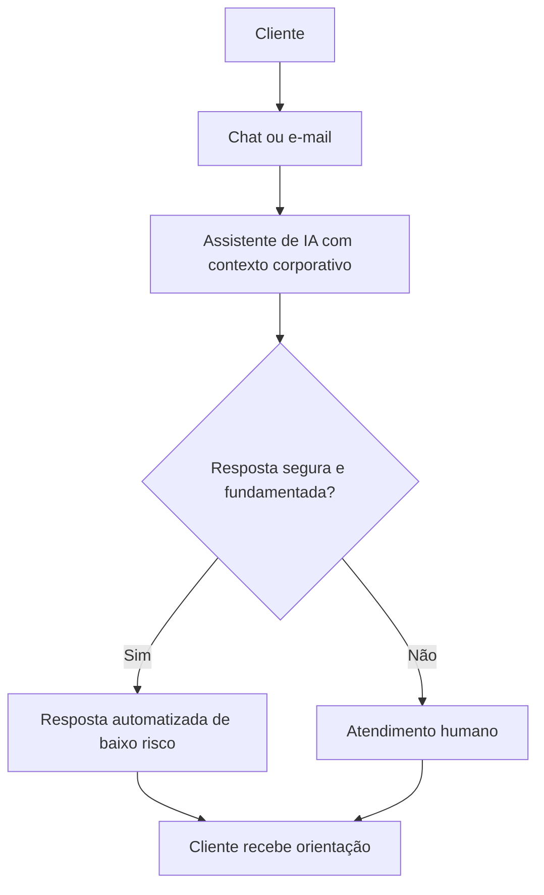

# Escopo da iniciativa

## Dentro do escopo

- Cenários de atendimento e base de conhecimento.
- Engenharia de prompts e integração com API de LLM.
- Execução experimental e avaliação de respostas.
- Análise de riscos, indicadores comparativos e recomendação técnica.

## Fora do escopo

- Chatbot em produção, integração com CRM real e atendimento a clientes reais.
- Treinamento de LLM e fine-tuning.
- Operações financeiras reais e acesso a dados confidenciais.
- Infraestrutura de produção e automação de decisões críticas.

## Visão operacional futura

Fluxo conceitual, não implementado nesta prova de conceito. Uma futura implantação exigirá controles independentes e supervisão humana.
